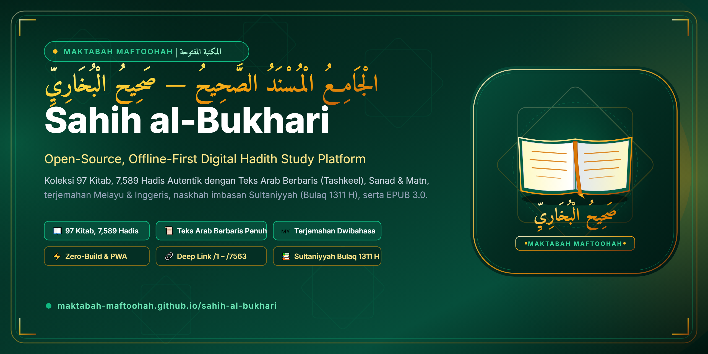

<p align="center">
  
</p>

# Maktabah Maftoohah — Sahih al-Bukhari (صحيح البخاري)

<p align="center">
  🇲🇾 <strong>Bahasa Melayu</strong> &nbsp;|&nbsp; 🇬🇧 <strong>English</strong>
</p>

[](https://maktabah-maftoohah.github.io/sahih-al-bukhari/)
[](manifest.webmanifest)
[](js/app.js)
[](data/collection.json)

**Maktabah Maftoohah Sahih al-Bukhari** ialah platform kajian digital hadis sumber terbuka, tanpa kompilasi (*zero-build*), dan berkeutamaan luar talian (*offline-first*) berteraskan piawaian **Maktabah Maftoohah** (المكتبة المفتوحة). Platform ini memuatkan keseluruhan teks autentik *Al-Jami' al-Musnad al-Sahih* karangan Amir al-Mu'minin fi al-Hadith, Imam Muhammad bin Ismail al-Bukhari (194–256 H).

🌐 **Aplikasi Web Langsung:** [https://maktabah-maftoohah.github.io/sahih-al-bukhari/](https://maktabah-maftoohah.github.io/sahih-al-bukhari/)

---

## 🌟 Ciri-Ciri Utama

### 📖 Koleksi Hadis Autentik Lengkap (97 Kitab, 7,589 Hadis)
* **Teks Arab Berbaris Penuh (*Tashkeel*)**: Dipelihara rapi berasaskan naskhah primer muktabar dengan ejaan dan tanda baca klasik.
* **Struktur Sanad & Matn Terperinci**: Pemisahan jelas antara rantaian perawi (*sanad*) dan intipati sabda/perbuatan Rasulullah SAW (*matn*).
* **Terjemahan Dwibahasa Lengkap**: Dilengkapi terjemahan lengkap Bahasa Melayu / Nusantara dan Bahasa Inggeris (Dr. Muhammad Muhsin Khan).

### 🔗 Pautan Terus Hadis & Pratonton Media Sosial (Deep-Linking)
Pautan terus boleh dikongsi secara terus ke mana-mana hadis tunggal:
* **Format Rasmi:** `https://maktabah-maftoohah.github.io/sahih-al-bukhari/{nombor}` (contoh: [`/1`](https://maktabah-maftoohah.github.io/sahih-al-bukhari/1), [`/42`](https://maktabah-maftoohah.github.io/sahih-al-bukhari/42))
* **Format Hash SPA:** `#hadith/{nombor}`, `#{nombor}`, `#book/{kitab}`
* **Kad Pratonton Kaya (*Rich Open Graph Preview*)**: Bot WhatsApp, Telegram, Facebook, Twitter/X, Discord, dan LinkedIn secara automatik membaca teks Arab dan terjemahan bagi hadis yang dikongsi bersama banner rasmi.
* **Butang "🔗 Salin Pautan"**: Tersedia pada setiap kad hadis untuk menyalin pautan terus dengan satu klik.

### 📚 Naskhah Cetakan Bersejarah & Dokumen Luar Talian
* **Al-Tab'ah al-Sultaniyyah (Bulaq 1311 H)**: Naskhah imbasan resolusi tinggi titah Sultan Abdul Hamid II mengikut naskhah al-Yuniniyyah ([`documents/bukhari-sultaniyyah-vol01.pdf`](documents/bukhari-sultaniyyah-vol01.pdf)).
* **E-Buku EPUB 3.0 Lengkap**: Seluruh 97 Kitab dalam satu fail e-buku serasi e-reader ([`documents/sahih-al-bukhari.epub`](documents/sahih-al-bukhari.epub)).
* **Katalog Arkib Imbasan Penuh**: Panduan muat turun naskhah 9 jilid lengkap Dar al-Ta'sil, Darussalam, dan Sultaniyyah ([`docs/SCANNED_EDITIONS.md`](docs/SCANNED_EDITIONS.md)).

---

## 🎨 Identiti Visual & Jenama

Aset penjenamaan rasmi disimpan di bawah direktori [`assets/`](assets/):

| Aset | Saiz | Penerangan |
| :--- | :--- | :--- |
| [`assets/logo.svg`](assets/logo.svg) & [`logo.png`](assets/logo.png) | 800 × 200 px (1600 × 400 Retina) | Logo mendatar rasmi dengan tipografi Arab & Latin |
| [`assets/logo-mark.svg`](assets/logo-mark.svg) & [`logo-mark.png`](assets/logo-mark.png) | 512 × 512 px | Lambang/emblem squircle Sahih al-Bukhari |
| [`assets/github-avatar.svg`](assets/github-avatar.svg) & [`github-avatar.png`](assets/github-avatar.png) | 512 × 512 px | Avatar bulat selamat potong (*circle-safe*) untuk profil GitHub |
| [`assets/site-banner.svg`](assets/site-banner.svg) & [`site-banner.png`](assets/site-banner.png) | 1280 × 640 px (2560 × 1280 Retina) | Banner tajuk & pratonton sosial repositori GitHub |
| [`assets/og-banner.jpg`](assets/og-banner.jpg) | 1280 × 640 px | Banner pratonton Open Graph & Twitter Cards |

Untuk menjana semula aset jenama:
```bash
python scripts/generate_branding.py
```

---

## 🛠️ Pembangunan & Pengesahan

```bash
# Jalankan pelayan dev tempatan
python scripts/serve.py --port 8000

# Pengesahan struktur projek & integriti data JSON
python scripts/verify_project.py
python scripts/verify_data_integrity.py

# Jana semula halaman pratonton Open Graph (/1 - /7563)
python scripts/generate_og_pages.py
```

---

## 📜 Invarian Maktabah Maftoohah
1. **Zero Text Generation**: Teks Al-Quran & Hadis tidak sekali-kali dijana atau ditokok-tambah oleh AI; kesemua data disumberkan daripada edisi primer muktabar.
2. **Subpath Hosting Compatibility**: Kesemua rujukan aset menggunakan laluan relatif (`./data/...`, `./css/...`, `./js/...`).
3. **Zero-Build Vanilla ES6**: Berjalan terus di pelayar tanpa kompilasi Webpack, Vite, atau runtime Node.
4. **UTF-8 Tanpa BOM**: Kesemua fail kod dan dataset mematuhi piawaian enkoding UTF-8 tanpa BOM.
